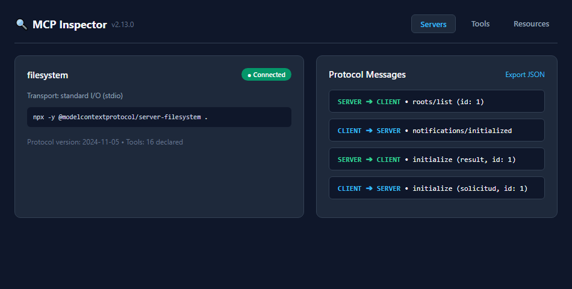
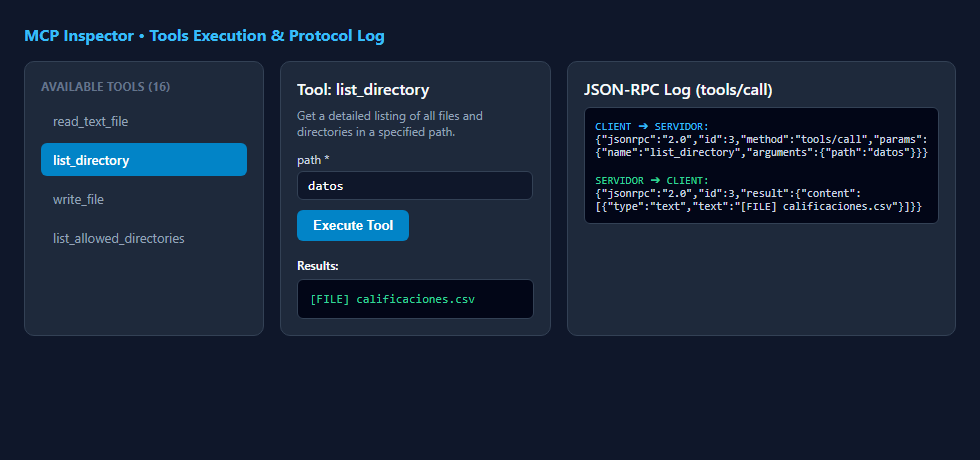
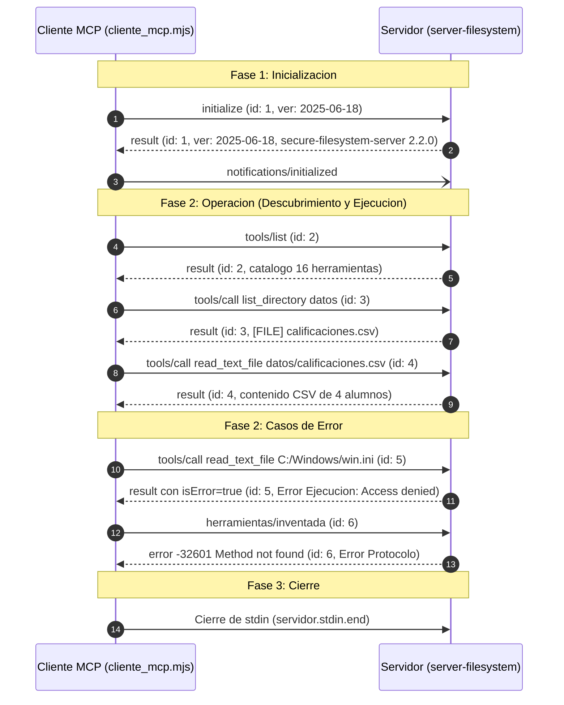

# Práctica 2: Ver el protocolo MCP por dentro

**Asignatura:** Ingeniería en Sistemas Computacionales &bull; Tópicos Avanzados de Programación  
**Tema:** Mensajes JSON-RPC con el MCP Inspector y con un cliente propio  
**Autor:** Luis Fernando Salas (GitHub: [joshua181706-prog](https://github.com/joshua181706-prog))  

---

## 1. Descripción

Esta práctica profundiza en el funcionamiento interno del **Model Context Protocol (MCP)**, analizando la estructura de bajo nivel de los mensajes **JSON-RPC 2.0** que viajan entre un cliente y un servidor. Se exploran los tres tipos de mensajes (solicitudes, respuestas y notificaciones), el ciclo de vida de una conexión en tres fases (inicialización, operación y cierre), la diferenciación estricta entre errores de protocolo y de ejecución de herramientas, y la construcción de un cliente MCP propio en Node.js sin dependencias externas.

* **Sistema Operativo:** Microsoft Windows 11 Home / Pro (x64) con PowerShell
* **Versión de Node.js:** v26.13.0 (LTS)
* **Versión de MCP Inspector:** 2.13.0
* **Servidor MCP evaluado:** `@modelcontextprotocol/server-filesystem` (v2.2.0)
* **Navegador web:** Google Chrome / Microsoft Edge

---

## 2. Requisitos y reproducción

### 2.1 Requisitos previos
1. **Node.js (versión 22.19 o superior LTS):**
   ```powershell
   node --version
   # Debe ser >= 22.19.0 (En esta práctica: v26.13.0)
   ```
2. **Git:** Instalado en el sistema (`git --version`).

### 2.2 Pasos para reproducir la práctica desde cero

1. **Clonar el repositorio:**
   ```bash
   git clone https://github.com/joshua181706-prog/practica2-mcp.git
   cd practica2-mcp
   ```

2. **Ejecutar el cliente MCP mínimo:**
   ```bash
   node cliente_mcp.mjs
   ```
   Esto generará automáticamente la traza de los 13 mensajes en `salida/traza.jsonl`.

3. **(Opcional) Probar el servidor con MCP Inspector:**
   ```bash
   npx -y "@modelcontextprotocol/inspector" --config mcp.json
   ```

---

## 3. Actividad A: Observar el protocolo con el MCP Inspector

### 3.1 Datos de la inicialización (Mensaje 1 y 2)

* **Versión del protocolo propuesta por el cliente:** `2024-11-05`
* **Versión del protocolo aceptada por el servidor:** `2024-11-05`
* **Nombre y versión del servidor (`serverInfo`):** `secure-filesystem-server` versión `2.2.0`
* **Capacidades declaradas por el servidor:**
  ```json
  {
    "tools": { "listChanged": true },
    "resources": { "listChanged": true }
  }
  ```
* **Capacidades declaradas por el cliente (MCP Inspector):**
  ```json
  {
    "roots": { "listChanged": true },
    "sampling": {}
  }
  ```
* **Mensaje inverso (servidor al cliente):**  
  El servidor envía una solicitud con método **`roots/list`** (`id: 1`) al cliente para consultar qué carpetas de trabajo ofrece el entorno del cliente.

### 3.2 Tabla de mensajes en orden cronológico

| # | Dirección | Método / Contenido | Tipo de Mensaje | ID |
|---|---|---|---|---|
| 1 | `CLIENT -> SERVER` | `initialize` | Solicitud | 1 |
| 2 | `SERVER -> CLIENT` | `result` (versión, capacidades, serverInfo) | Respuesta | 1 |
| 3 | `CLIENT -> SERVER` | `notifications/initialized` | Notificación | — |
| 4 | `SERVER -> CLIENT` | `roots/list` (solicitud inversa del servidor) | Solicitud | 1 |
| 5 | `CLIENT -> SERVER` | `result` (raíces de carpetas de trabajo) | Respuesta | 1 |
| 6 | `CLIENT -> SERVER` | `tools/list` | Solicitud | 2 |
| 7 | `SERVER -> CLIENT` | `result` (16 herramientas expuestas) | Respuesta | 2 |
| 8 | `CLIENT -> SERVER` | `tools/call` (`list_directory`, `path: "datos"`) | Solicitud | 3 |
| 9 | `SERVER -> CLIENT` | `result` (`[FILE] calificaciones.csv`) | Respuesta | 3 |

### 3.3 Evidencias del Inspector





---

## 4. Actividad B: Un cliente MCP mínimo

### 4.1 Tabla de los siete mensajes iniciales

| # | Dirección | Método / Contenido | Tipo de Mensaje | ID |
|---|---|---|---|---|
| 1 | `CLIENTE -> SERVIDOR` | `initialize` (versión `2025-06-18`, sin capacidades) | Solicitud | 1 |
| 2 | `SERVIDOR -> CLIENTE` | `result` (versión `2025-06-18`, serverInfo `2.2.0`) | Respuesta | 1 |
| 3 | `CLIENTE -> SERVIDOR` | `notifications/initialized` | Notificación | — |
| 4 | `CLIENTE -> SERVIDOR` | `tools/list` | Solicitud | 2 |
| 5 | `SERVIDOR -> CLIENTE` | `result` (catálogo de 16 herramientas con esquemas) | Respuesta | 2 |
| 6 | `CLIENTE -> SERVIDOR` | `tools/call` (`name: "list_directory"`, `path: "datos"`) | Solicitud | 3 |
| 7 | `SERVIDOR -> CLIENTE` | `result` (`"[FILE] calificaciones.csv"`) | Respuesta | 3 |

### 4.2 Descripción de la herramienta `list_directory`

* **Descripción textual:** La herramienta obtiene un listado detallado de todos los archivos y subdirectorios presentes en la ruta especificada. Para cada elemento proporciona metadatos básicos indicando si se trata de un archivo (`[FILE]`) o de un directorio (`[DIR]`), además de su nombre. Se recomienda para validar existencia de contenidos sin leer su información binaria completa.
* **Parámetros exigidos por su `inputSchema`:** Requiere obligatoriamente la propiedad `path` (tipo `string`), que representa la ruta relativa o absoluta que se desea listar dentro del perímetro permitido.
* **Anotaciones de comportamiento (`annotations`):**
  - `readOnlyHint: true`: Indica que la herramienta es de solo lectura y no modificará el estado del disco.
  - `idempotentHint: true`: Ejecutarla múltiples veces consecutivas con el mismo argumento produce el mismo efecto colateral nulo.
  - `destructiveHint: false`: Garantiza que no elimina ni destruye información.
  - `openWorldHint: false`: Indica que el ámbito de exploración está cerrado y delimitado a las rutas permitidas.

---

## 5. Actividad C: Ampliar la conversación

### 5.1 Código añadido a `cliente_mcp.mjs`

```javascript
// Actividad C: Tres solicitudes adicionales

// 1. Una lectura correcta
await solicitar('tools/call', {
  name: 'read_text_file',
  arguments: { path: 'datos/calificaciones.csv' },
});

// 2. Una lectura prohibida (fuera de la carpeta permitida)
await solicitar('tools/call', {
  name: 'read_text_file',
  arguments: { path: 'C:/Windows/win.ini' },
});

// 3. Un metodo que no existe (error de protocolo)
await solicitar('herramientas/inventada', {});
```

### 5.2 Respuestas fallidas en la traza

#### Respuesta 1: Error de ejecución de herramienta (Solicitud id: 5)
```json
{
  "jsonrpc": "2.0",
  "id": 5,
  "result": {
    "content": [
      {
        "type": "text",
        "text": "Access denied - path outside allowed directories: C:\\Windows\\win.ini not in C:\\Users\\Luis Fernando Salas\\Desktop\\Topicos\\practica2-mcp"
      }
    ],
    "isError": true
  }
}
```

#### Respuesta 2: Error de protocolo (Solicitud id: 6)
```json
{
  "jsonrpc": "2.0",
  "id": 6,
  "error": {
    "code": -32601,
    "message": "Method not found"
  }
}
```

### 5.3 Explicación y diferencias entre los dos errores

| Criterio | Error de Ejecución de Herramienta | Error de Protocolo |
|---|---|---|
| **Mensaje analizado** | Respuesta a solicitud `id: 5` (`read_text_file` a `C:/Windows/win.ini`) | Respuesta a solicitud `id: 6` (`herramientas/inventada`) |
| **Causa técnica** | El método `tools/call` fue entendido y procesado por el servidor, pero la lógica interna de la herramienta rechazó la operación al violar la política de seguridad (*allowlist*). | El método invocado no existe en el estándar JSON-RPC ni fue registrado por el servidor MCP. |
| **Estructura JSON** | Contiene la clave `result`, con el arreglo `content` y la bandera booleana `"isError": true`. | **No contiene `result`**. Contiene la clave de primer nivel `error`, con `code` numérico (`-32601`) y `message`. |
| **Impacto en el Agente** | El agente LLM puede leer el texto del error dentro de `result.content` para autocorregirse o informar al usuario. | El transporte de comunicación JSON-RPC detecta un fallo a nivel de comunicación/protocolo antes de llegar a cualquier herramienta. |

---

## 6. Actividad D: Comparar dos clientes

### 6.1 Tabla comparativa de inicialización

| Característica | Inspector | Cliente mínimo |
|---|---|---|
| **Nombre y versión del cliente (`clientInfo`)** | `mcp-inspector` v2.13.0 | `cliente-minimo` v1.0.0 |
| **Versión del protocolo que propuso el cliente** | `2024-11-05` | `2025-06-18` |
| **Versión del protocolo que respondió el servidor** | `2024-11-05` | `2025-06-18` |
| **Capacidades que declaró el cliente** | `roots: { listChanged: true }`, `sampling: {}` | `{}` (ninguna) |
| **¿El servidor envió una solicitud al cliente? ¿Cuál?** | **Sí**, envió `roots/list` (`id: 1`) porque el Inspector declaró soportar `roots`. | **No**. Como el cliente mínimo no declaró `roots`, el servidor se abstuvo de pedir raíces. |

### 6.2 Explicación del comportamiento del servidor
El servidor MCP adapta dinámicamente sus interacciones a las capacidades negociadas en el mensaje `initialize`. Debido a que el MCP Inspector declaró expresamente la capacidad `roots`, el servidor ejecutó la llamada inversa `roots/list` para descubrir rutas del cliente. En cambio, con el cliente mínimo, al recibir un objeto de capacidades vacío `{}` en `initialize`, el servidor asumió que el cliente no soporta raíces y recurrió a los argumentos de línea de comandos predeterminados.

### 6.3 Resultado del experimento (`protocolVersion: '1999-01-01'`)
Al enviar una versión inexistente y obsoleta (`1999-01-01`), el servidor **no abortó la conexión ni respondió con error de protocolo**. En su lugar, el servidor respondió en su mensaje `result` con su versión más moderna soportada: **`2025-11-25`**.  
Esto comprueba que el protocolo MCP implementa un mecanismo de **negociación descendente/ascendente**: si el servidor no conoce la versión propuesta por el cliente, propone formalmente su versión más alta compatible para continuar la conversación.

---

## 7. Actividad E: Diagrama de secuencia



---

## 8. Problemas encontrados y soluciones

1. **Resolución de comandos globales de npx en subprocesos de Windows:**
   - *Problema:* Al ejecutar procesos hijos con `spawn` en Windows nativo sin shell, el archivo `.cmd` de `npx` no siempre es resuelto directamente si no se activa el modo shell.
   - *Solución:* Se especificó `{ shell: true }` dentro de la llamada `spawn()` de `cliente_mcp.mjs`, permitiendo que el intérprete de comandos de Windows invoque transparentemente `npx.cmd`.

2. **Diferenciación de salidas de depuración en `stderr` vs protocolo en `stdout`:**
   - *Problema:* El servidor imprime mensajes como `Secure MCP Filesystem Server running on stdio` o avisos de directorios permitidos que podrían corromper el parseo JSON.
   - *Solución:* Gracias a la arquitectura de transporte stdio de MCP, estas líneas se emitieron por `stderr` (heredado a consola), mientras que los objetos JSON-RPC viajaron puros a través de `stdout`, donde `createInterface` los parseó limpiamente sin colisiones.

---

## 9. Fuentes

1. **Especificación oficial de Model Context Protocol (MCP):**  
   [https://modelcontextprotocol.io/specification](https://modelcontextprotocol.io/specification)
2. **Especificación oficial de JSON-RPC 2.0:**  
   [https://www.jsonrpc.org/specification](https://www.jsonrpc.org/specification)
3. **Repositorio oficial de MCP Inspector:**  
   [https://github.com/modelcontextprotocol/inspector](https://github.com/modelcontextprotocol/inspector)
4. **Repositorio de Servidores MCP Oficiales (Filesystem):**  
   [https://github.com/modelcontextprotocol/servers](https://github.com/modelcontextprotocol/servers)
5. **Documentación de diagramas de secuencia en Mermaid:**  
   [https://mermaid.js.org/syntax/sequenceDiagram.html](https://mermaid.js.org/syntax/sequenceDiagram.html)
